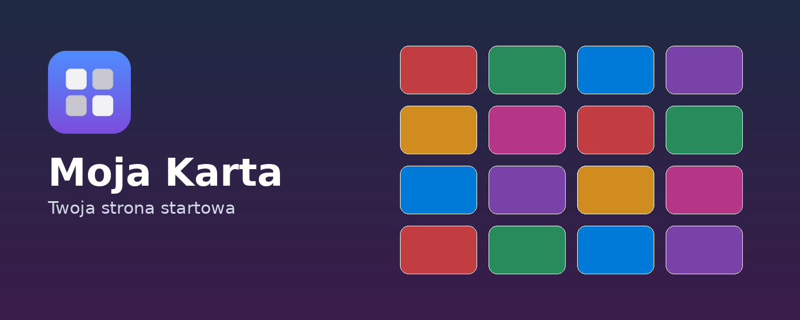
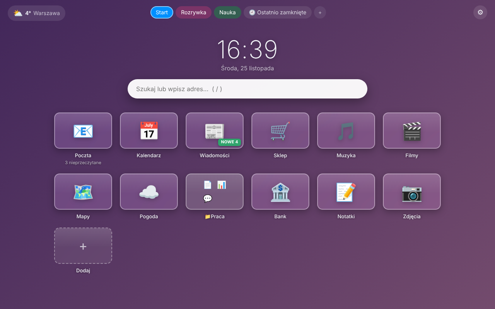
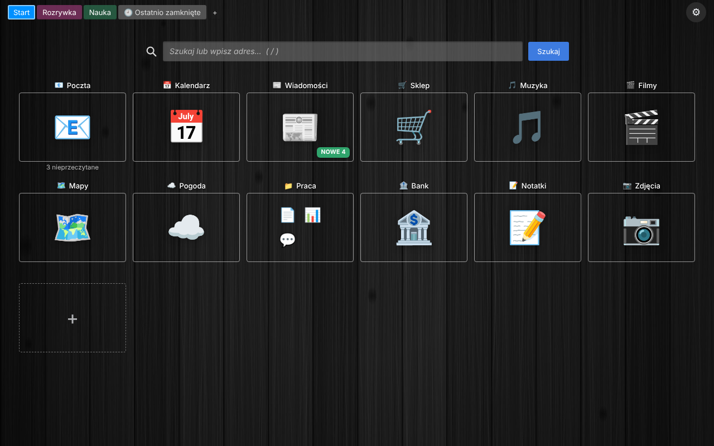
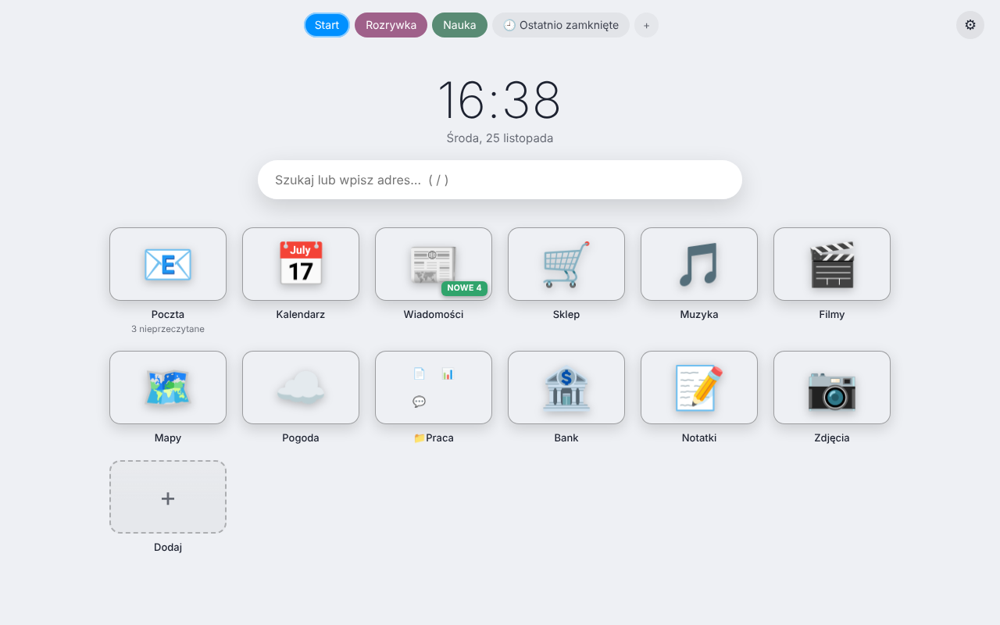
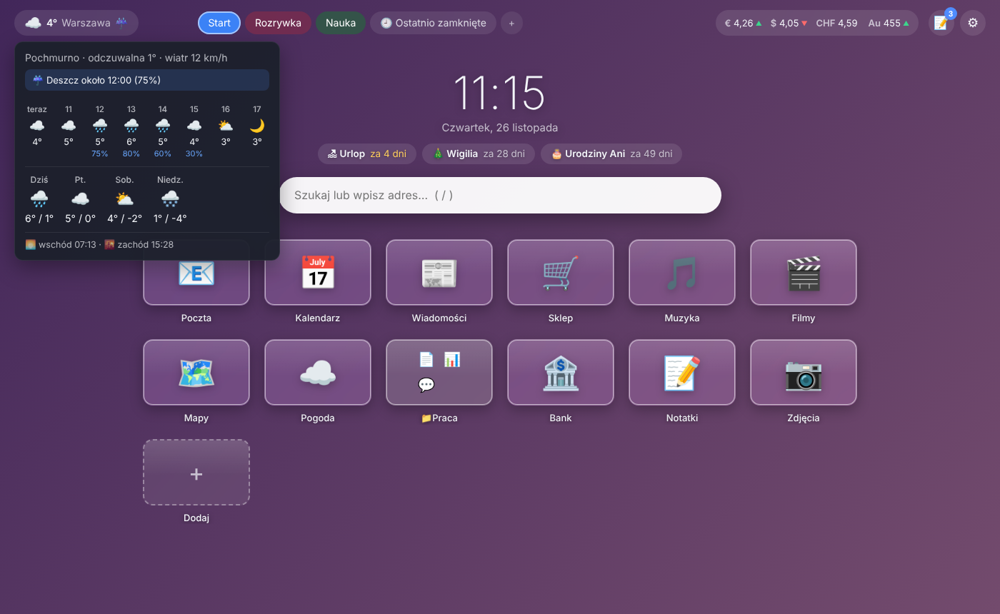
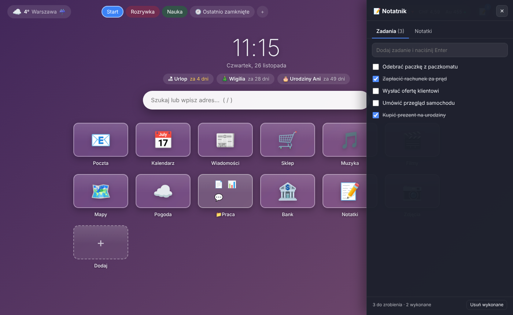
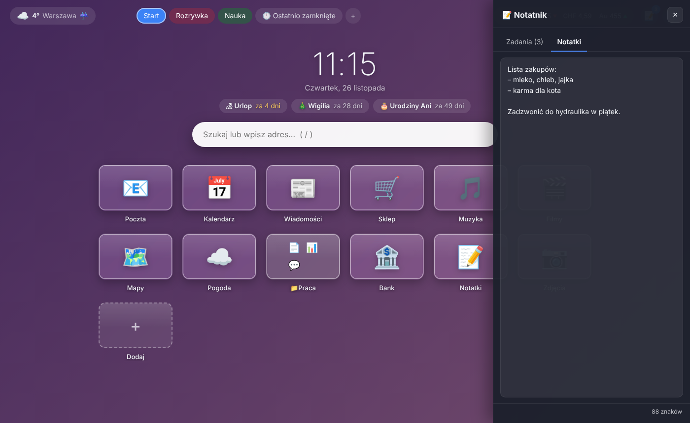
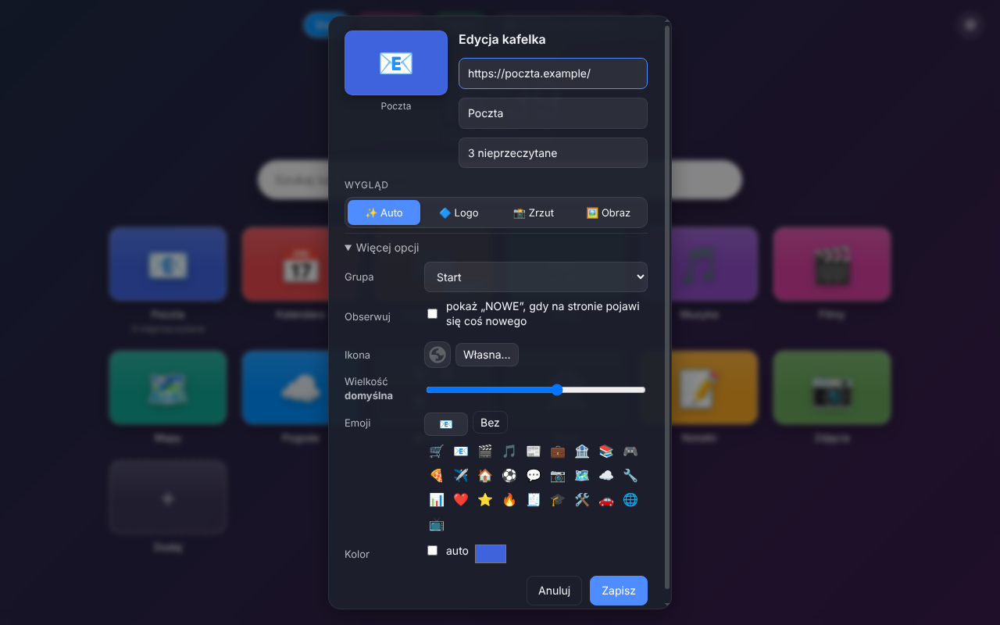
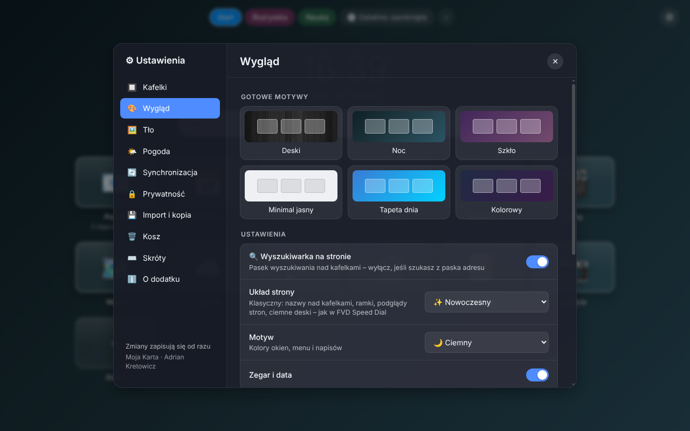
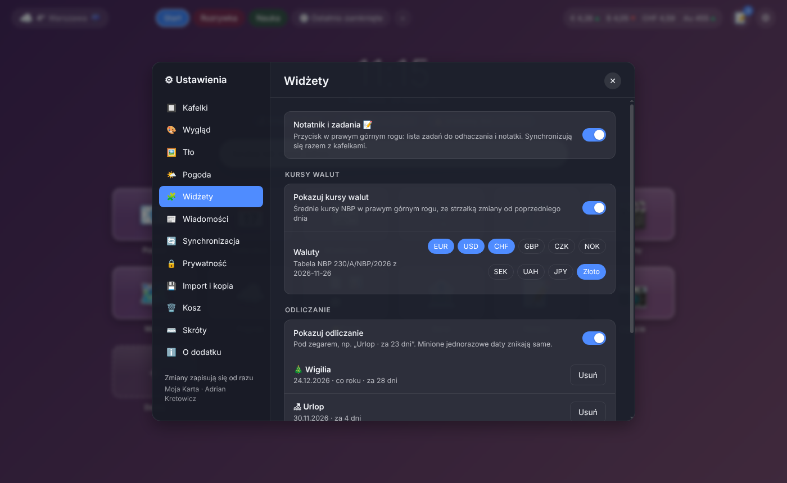

<p align="center">
  
</p>

<p align="center">
  <b>Twoja strona startowa w przeglądarce – kafelki ulubionych stron, pogoda, notatki i wiele więcej.</b>
</p>

<p align="center">
  
  
  
  
  
</p>

<p align="center">
  <a href="#-zrzuty-ekranu">Zrzuty ekranu</a> •
  <a href="#-funkcje">Funkcje</a> •
  <a href="#-instalacja">Instalacja</a> •
  <a href="#-skróty-klawiszowe">Skróty</a> •
  <a href="#-prywatność">Prywatność</a> •
  <a href="#-budowa-projektu">Budowa projektu</a>
</p>

---

## 📸 Zrzuty ekranu

<p align="center">
  
</p>

<table>
  <tr>
    <td width="50%" align="center"><br><sub><b>Układ klasyczny</b> – nazwy nad kafelkami, cienkie ramki, ciemne deski</sub></td>
    <td width="50%" align="center"><br><sub><b>Motyw jasny</b> – gotowe motywy jednym kliknięciem</sub></td>
  </tr>
  <tr>
    <td width="50%" align="center"><br><sub><b>Pogoda i widżety</b> – prognoza godzinowa, ostrzeżenie o deszczu, kursy walut, odliczanie</sub></td>
    <td width="50%" align="center"><br><sub><b>Lista zadań</b> – odhaczanie, edycja, zmiana kolejności</sub></td>
  </tr>
  <tr>
    <td width="50%" align="center"><br><sub><b>Notatki</b> – zapisują się same i synchronizują</sub></td>
    <td width="50%" align="center"><br><sub><b>Edycja kafelka</b> – logo, podgląd strony albo własny obraz</sub></td>
  </tr>
  <tr>
    <td width="50%" align="center"><br><sub><b>Ustawienia</b> – czytelne zakładki</sub></td>
    <td width="50%" align="center"><br><sub><b>Widżety</b> – waluty, odliczanie, notatnik</sub></td>
  </tr>
</table>

---

## ✨ Funkcje

### 🗂️ Kafelki i porządek
| | |
|---|---|
| 📁 **Grupy i foldery** | kolorowe zakładki grup, foldery tworzone przeciągnięciem kafelka na kafelek |
| 🖱️ **Przeciąganie** | zmiana kolejności, przenoszenie między grupami, dodawanie stron przeciągnięciem linku z innej karty, zakładek albo pulpitu |
| ☑️ **Zaznaczanie wielu** | przenoszenie, usuwanie i tworzenie folderu z kilku kafelków naraz |
| 🗑️ **Kosz** | usunięte kafelki i grupy można przywrócić przez 30 dni |
| 🔁 **Duplikaty** | wyszukiwanie i usuwanie powtórzonych stron |
| 🕘 **Ostatnio zamknięte** | przywracanie kart zamkniętych przez pomyłkę |

### 🎨 Wygląd
| | |
|---|---|
| 🪵 **Dwa układy** | nowoczesny albo klasyczny (nazwa nad kafelkiem, cienkie ramki, deski) |
| 🖼️ **Logo w wysokiej jakości** | automatyczne wyszukiwanie logo strony, podgląd strony albo własny obraz |
| 🌄 **Tła** | gradient, kolor, własne zdjęcie, zmieniające się zdjęcia, tapeta dnia; osobne tło dla każdej grupy, kadrowanie |
| ❄️ **Animowane tło** | śnieg, gwiazdy, deszcz, świetliki |
| ✨ **Efekty kafelków** | uniesienie, powiększenie, podświetlenie albo efekt 3D za kursorem |
| 🎭 **Motywy** | Deski, Noc, Szkło, Minimal jasny, Tapeta dnia, Kolorowy |

### 🧩 Widżety
| | |
|---|---|
| 🌤️ **Pogoda** | prognoza godzinowa i na 4 dni, ostrzeżenie o deszczu, wschód i zachód słońca |
| 📝 **Notatnik i zadania** | panel boczny z listą zadań i notatkami |
| 💶 **Kursy walut** | średnie kursy NBP ze strzałką zmiany, cena złota |
| ⏳ **Odliczanie** | „Urlop · za 4 dni”, daty co roku wracają same |
| 📰 **Wiadomości** | czytnik RSS z ulubionych stron i forów |
| 🔔 **Liczniki** | nieprzeczytane maile w Gmailu, powiadomienia z Facebooka |
| 🩺 **Monitoring** | czerwona kropka, gdy strona nie działa, znaczek „NOWE”, gdy pojawi się nowa treść |

### 🔒 Prywatność i dane
| | |
|---|---|
| 🔑 **PIN** | prywatne grupy chronione PIN-em |
| 🕶️ **Incognito** | wybrane kafelki zawsze otwierają się w oknie prywatnym |
| 🔐 **Tylko do odczytu** | blokada przypadkowych zmian |
| ☁️ **Synchronizacja** | przez konto Google w Chrome (opcjonalnie) |
| 💾 **Kopie zapasowe** | automatyczne do folderu Pobrane, eksport i import z pliku, import z zakładek |

---

## 🚀 Instalacja

<details open>
<summary><b>Chrome</b></summary>

1. Pobierz kod: zielony przycisk **Code → Download ZIP** i rozpakuj archiwum.
2. Wpisz w pasku adresu `chrome://extensions`.
3. W prawym górnym rogu włącz **Tryb dewelopera**.
4. Kliknij **Załaduj rozpakowane** i wskaż rozpakowany folder (ten z plikiem `manifest.json`).
5. Otwórz nową kartę – **Ctrl+T**.

> 💡 Po aktualizacji plików kliknij ↻ przy Mojej Karcie w `chrome://extensions`.
</details>

<details>
<summary><b>Microsoft Edge</b></summary>

Tak samo jak w Chrome, pod adresem `edge://extensions` (przełącznik **Tryb dewelopera** jest na dole po lewej). Jeśli Edge zapyta o zmianę strony nowej karty, wybierz **Zachowaj zmiany**.
</details>

<details>
<summary><b>Opera</b></summary>

Instalacja pod adresem `opera://extensions`. Opera nie pozwala dodatkom zastąpić nowej karty, dlatego Moja Karta otwiera się przy starcie przeglądarki i z ikony dodatku na pasku.
</details>

---

## ⚡ Skróty klawiszowe

| Skrót | Działanie |
|:---:|---|
| <kbd>/</kbd> | przejście do wyszukiwarki |
| <kbd>Alt</kbd> + <kbd>1</kbd> … <kbd>9</kbd> | przełączanie grup |
| <kbd>Ctrl</kbd> + <kbd>←</kbd> / <kbd>→</kbd> | poprzednia / następna grupa |
| <kbd>Ctrl</kbd> + <kbd>A</kbd> | zaznaczenie wszystkich kafelków |
| <kbd>Delete</kbd> | usunięcie zaznaczonych kafelków |
| <kbd>Esc</kbd> | zamknięcie okna lub panelu |

---

## 🔐 Prywatność

- ✅ **Bez kont, bez reklam, bez śledzenia** – dane zostają w przeglądarce użytkownika.
- ✅ Synchronizacja odbywa się wyłącznie przez konto Google użytkownika.
- ✅ Usługi zewnętrzne są używane tylko wtedy, gdy dana funkcja jest włączona, i nie dostają danych identyfikujących użytkownika:

| Usługa | Do czego |
|---|---|
| Google (gstatic) | ikony stron |
| everhelper.pro | galeria logo stron |
| Open-Meteo | pogoda |
| Narodowy Bank Polski | kursy walut i cena złota |
| Bing | tapeta dnia |
| Gmail | liczba nieprzeczytanych maili |

---

## 🧱 Budowa projektu

```
moja-karta/
├── manifest.json     opis rozszerzenia (Manifest V3)
├── newtab.html       strona nowej karty i ustawienia
├── newtab.css        wygląd
├── newtab.js         logika strony: kafelki, grupy, widżety, ustawienia
├── background.js     działanie w tle: menu, liczniki, podglądy, monitoring, kopie
├── storage.js        zapis danych i synchronizacja
├── images.js         wyszukiwanie logo i ikon stron
├── rss.js            czytnik wiadomości RSS/Atom
├── fx.js             animowane tło
├── popup.html/.js    okienko „Dodaj do Mojej Karty”
└── icons/            ikony rozszerzenia
```

Czysty JavaScript – bez bibliotek zewnętrznych i bez narzędzi do budowania.

---

<p align="center">
  <b>Moja Karta</b> · © 2026 <b>Adrian Kretowicz</b> · Wszelkie prawa zastrzeżone
</p>
